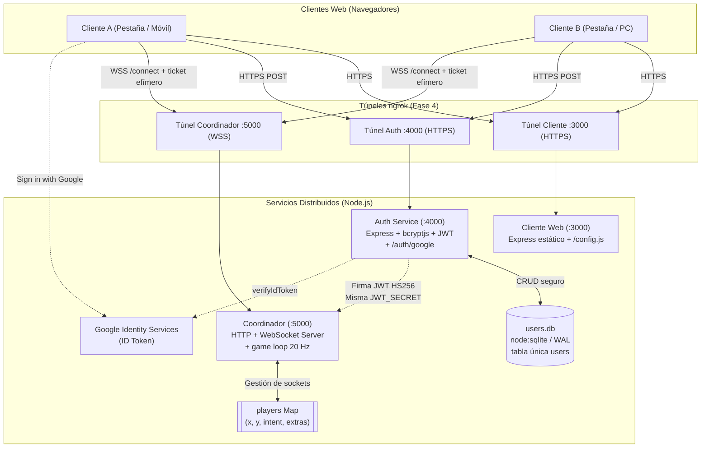
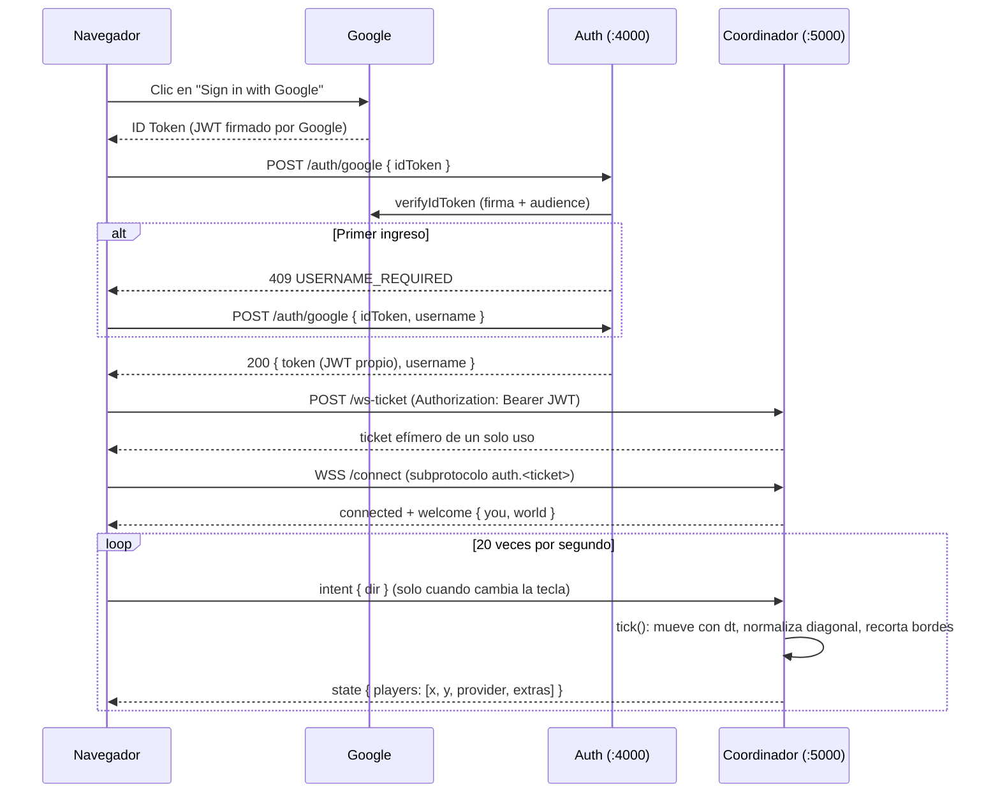
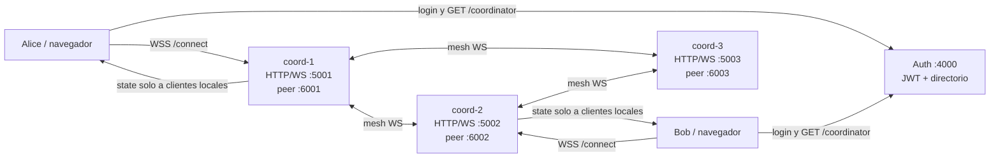

# Talleres 4, 5 y 6: Sistemas Distribuidos — Proyecto Final (Partes I–III)

> **Universidad de Boyacá — Facultad de Ciencias e Ingeniería**  
> **Asignatura:** Sistemas Distribuidos  
> **Repositorio Oficial:** [https://github.com/juandiegobb/SSD-CarsGame.git](https://github.com/juandiegobb/SSD-CarsGame.git)  

Este repositorio contiene el videojuego web multijugador **SSD-CarsGame**:

* **Parte I (Taller 4) — Identidad:** registro, login con JWT, persistencia en SQLite, presencia de jugadores en vivo por WebSocket y despliegue con ngrok.
* **Parte II (Taller 5) — Juego en vivo + Google:** cada jugador maneja un carro en un canvas, con el **servidor como autoridad** (game loop a 20 Hz), **login con Google** que convive con el login local en una sola tabla `users`, y un **feature extra replicado** (color del carro e insignia de provider). Ver la [sección 11](#11-taller-5--parte-ii-juego-en-vivo-y-login-con-google).
* **Parte III (Taller 6) — Coordinadores distribuidos:** varios coordinadores mantienen presencia, movimiento, salas, colores y fotos sincronizados por un mesh WebSocket. El Auth selecciona el menos cargado y el cliente vuelve a consultarlo cuando pierde la conexión. La demo usa tres, pero se pueden agregar más y ejecutarlos en equipos distintos. Ver la [sección 12](#12-taller-6--coordinadores-distribuidos-y-mesh).

> ℹ️ **Nota de alcance:** el estado distribuido vive en memoria. Si cae un coordinador, sus jugadores remotos se eliminan; no se persiste ni se recupera el estado de ese proceso.

---

## Tabla de Contenido
1. [Arquitectura del Sistema](#1-arquitectura-del-sistema)
2. [Estructura del Repositorio](#2-estructura-del-repositorio)
3. [Requisitos Previos](#3-requisitos-previos)
4. [Instalación y Puesta en Marcha](#4-instalación-y-puesta-en-marcha)
5. [Referencia de API (Contratos y Códigos)](#5-referencia-de-api-contratos-y-códigos)
6. [Pruebas de la API (curl y Thunder Client)](#6-pruebas-de-la-api-curl-y-thunder-client)
7. [Pruebas del WebSocket (wscat)](#7-pruebas-del-websocket-wscat)
8. [Decisiones de Diseño Justificadas](#8-decisiones-de-diseño-justificadas)
9. [Despliegue Público con ngrok](#9-despliegue-público-con-ngrok)
10. [Errores Típicos y Cómo Evitarlos](#10-errores-típicos-y-cómo-evitarlos)
11. [Taller 5 — Parte II: Juego en Vivo y Login con Google](#11-taller-5--parte-ii-juego-en-vivo-y-login-con-google)
12. [Taller 6 — Coordinadores Distribuidos y Mesh](#12-taller-6--coordinadores-distribuidos-y-mesh)
13. [Equipo y Reparto de Fases](#13-equipo-y-reparto-de-fases)

---

## 1. Arquitectura del Sistema

El sistema separa Auth, Client y los procesos Coordinator. En el Taller 6 se
levantan varios coordinadores independientes (tres en el diagrama), cada uno con un puerto para
clientes y otro para el mesh (ver la [sección 12](#12-taller-6--coordinadores-distribuidos-y-mesh)).



### Flujo de Vida de una Sesión:
1. **Registro:** El cliente envía `POST /register` con `{ username, password }` al Auth Service. El password se hashea con `bcrypt` (10 rounds) y se guarda en SQLite.
2. **Login:** El cliente envía `POST /login`. El Auth Service valida las credenciales y genera un **JWT** firmado (algoritmo `HS256`, vigencia configurable).
3. **Handshake WebSocket:** El cliente envía el JWT al coordinador por `POST /ws-ticket` en el header `Authorization` y recibe un ticket aleatorio de un solo uso, válido por 15 segundos. El ticket viaja en un subprotocolo del handshake `ws://` (o `wss://`); el JWT no aparece en la URL ni en mensajes WebSocket.
4. **Presencia en Vivo:** El Coordinador registra al jugador en un `Map` en memoria (`userId -> { username, socket, ... }`) y emite un broadcast `players_update` a todos los clientes conectados.
5. **Juego (Taller 5):** El cliente envía `intent` con la dirección de las teclas; el game loop del Coordinador mueve a cada jugador y difunde un `state` 20 veces por segundo. Con Google, el paso 2 se reemplaza por `POST /auth/google` y el resto es idéntico (mismo JWT).

**Riesgo residual del cliente:** el JWT de login se guarda en `localStorage` para que la aplicación web pueda recuperarlo al recargar. Cualquier JavaScript ejecutado en el origen del cliente podría leerlo; por ello se evita insertar datos del servidor con `innerHTML` y no se deben agregar scripts de terceros sin revisión. Cambiar a una sesión `HttpOnly` exigiría una arquitectura de sesión/proxy distinta y queda fuera de este cambio.

---

## 2. Estructura del Repositorio

```text
SSD-CarsGame/
├── auth-service/              # Servicio de Autenticación (Puerto 4000)
│   ├── index.js               # API REST Express, SQLite, emisor de JWT y /auth/google
│   ├── package.json           # Dependencias: express, bcryptjs, jsonwebtoken, dotenv, cors, google-auth-library (+ node:sqlite)
│   ├── .env.example           # Plantilla de variables de entorno del Auth
│   └── users.db               # Base de datos SQLite (ignorado en .gitignore)
├── coordinator/               # Coordinador de Sesiones WebSocket (Puerto 5000)
│   ├── index.js               # Verificación en upgrade, Map de jugadores, game loop y broadcast
│   ├── package.json           # Dependencias: express, ws, jsonwebtoken, dotenv
│   ├── .env.example           # Plantilla de variables de entorno del Coordinador
│   ├── start-coordinators.ps1 # Arranque local de una cantidad configurable de instancias
│   └── start-three.ps1        # Alias de compatibilidad
├── client/                    # Cliente Web Frontend y Servidor Estático (Puerto 3000)
│   ├── server.js              # Servidor Express estático y endpoint dinámico /config.js
│   ├── package.json           # Dependencias: express, dotenv
│   ├── .env.example           # Plantilla de variables del cliente
│   └── public/                # Archivos estáticos del frontend
│       ├── login.html         # Registro, Iniciar Sesión y botón Sign in with Google
│       ├── lobby.html         # Pista del juego, color del carro, jugadores conectados y logout
│       ├── game.js            # Canvas: teclado → intent y dibujo de cada state
│       ├── common.js          # Utilidades compartidas (API, localStorage, headers)
│       └── style.css          # Estilos visuales del cliente
├── docs/                      # Documentación técnica adicional
│   └── ngrok.md               # Guía completa de despliegue con ngrok
├── worker/                    # Componente reservado para futuras fases (física/movimiento)
│                              # (No se utiliza en este Taller 4 - Parte I)
├── ngrok.example.yml          # Plantilla v3 para los 5 endpoints locales
├── .env.example               # Referencia global de variables
├── .gitignore                 # Reglas de exclusión (ignora .env, *.db, node_modules)
├── SPEC.md                    # Especificación formal y contratos del taller
├── AGENTS.md                  # Roles, guías colaborativas y políticas de desarrollo
└── README.md                  # Documentación principal del proyecto
```

---

## 3. Requisitos Previos

* **Node.js:** Versión `22.13.0` o superior (el auth usa `node:sqlite`, incluido en Node). Recomendado: `Node.js 22.x LTS` o `24.x`.
  * *Verificado y probado con Node.js v24.20.0 y npm v11.19.0.*
* **npm:** Gestor de paquetes incluido con Node.js.
* **ngrok:** CLI oficial de ngrok (v3.x) para túneles públicos.
* **Cuenta de Google Cloud (gratis):** solo para crear el Client ID del login con Google ([sección 11.3](#113-configurar-google-cloud-client-id)).
* **Chrome o Edge:** el login con Google abre una ventana emergente que el navegador integrado de VS Code no soporta.
* **wscat (opcional para terminal):** Cliente de terminal para WebSockets (`npm install -g wscat`).
* **Thunder Client / Postman / curl:** Para pruebas de endpoints HTTP.

---

## 4. Instalación y Puesta en Marcha

### 4.1. Clonar el Repositorio
```bash
git clone https://github.com/juandiegobb/SSD-CarsGame.git
cd SSD-CarsGame
```

### 4.2. Instalar Dependencias
Cada servicio es un paquete independiente con su propio `package.json`:
```bash
npm install --prefix auth-service
npm install --prefix coordinator
npm install --prefix client
```

### 4.3. Configuración de Variables de Entorno (`.env`)

Copia los archivos de ejemplo en cada servicio:

1. **Generar una `JWT_SECRET` segura:**
   Ejecuta el siguiente comando en tu terminal para generar una clave criptográfica aleatoria de 32 bytes:
   ```bash
   node -e "console.log(require('crypto').randomBytes(32).toString('hex'))"
   ```

2. **Configurar `auth-service/.env`:**
   ```dotenv
   PORT=4000
   JWT_SECRET=pega_aqui_la_clave_generada
   JWT_EXPIRES_IN=1h
   BCRYPT_ROUNDS=10
   DB_PATH=users.db
   CORS_ORIGINS=http://localhost:3000
   COORDINATOR_SHARED_SECRET=reemplaza_con_un_secreto_local_compartido
   GOOGLE_CLIENT_ID=xxxx.apps.googleusercontent.com   # Taller 5 (opcional)
   ```
   > `JWT_SECRET` debe tener **al menos 32 caracteres** (exigencia del Taller 5); si no, el auth no arranca.

3. **Configurar `coordinator/.env`:**
   > ⚠️ **CRÍTICO:** La variable `JWT_SECRET` debe ser **EXACTAMENTE LA MISMA** que la configurada en `auth-service/.env`. Si difieren, el Coordinador rechazará los tokens con error `TOKEN_INVALID_SIGNATURE`.
   ```dotenv
   PORT=5000
   COORDINATOR_ID=coord-5000
   PEER_PORT=6000
   PUBLIC_URL=ws://localhost:5000
   PEER_URL=ws://localhost:6000
   AUTH_URL=http://localhost:4000
   JWT_SECRET=pega_aqui_la_clave_generada
   COORDINATOR_SHARED_SECRET=reemplaza_con_el_mismo_secreto_local_de_auth
   # Taller 5 (opcionales): WORLD_WIDTH=800 WORLD_HEIGHT=600 PLAYER_RADIUS=20 PLAYER_SPEED=200 TICK_RATE=20
   ```
   `COORDINATOR_SHARED_SECRET` es obligatorio y debe coincidir con el valor local de `auth-service/.env`; no reutilices `JWT_SECRET` para ese propósito.
   `PORT` es el puerto HTTP/WebSocket de clientes; `PEER_PORT` es el listener WebSocket de coordinadores. Para iniciar una instancia:
   ```powershell
   npm start --prefix coordinator
   ```
   Para iniciar tres coordinadores independientes en puertos HTTP `5001`–`5003` y peer `6001`–`6003`:

   ```powershell
   .\coordinator\start-coordinators.ps1
   ```
   Puedes cambiar la cantidad con `-Count 5` (genera HTTP `5001`–`5005` y peer `6001`–`6005`), o indicar listas iguales de puertos, IDs y URLs. El script comprueba los puertos, comparte `AUTH_URL` y `COORDINATOR_SHARED_SECRET` configurados en el entorno o en `coordinator/.env`, y restaura las variables temporales al terminar. Cada instancia registra heartbeats, consulta `GET /peers` y mantiene sus conexiones mesh.

4. **Configurar `client/.env`:**
   ```dotenv
   PORT=3000
   AUTH_URL=http://localhost:4000
   COORDINATOR_WS_URL=ws://localhost:5000
   GOOGLE_CLIENT_ID=xxxx.apps.googleusercontent.com   # Taller 5: el mismo que en el auth
   ```

> 💡 **Recarga en caliente de `JWT_EXPIRES_IN`:** La variable `JWT_EXPIRES_IN` en `auth-service/.env` se relee dinámicamente en cada petición `POST /login` (con `dotenv.parse`), permitiendo cambiar la expiración a `10s` o `30s` sin reiniciar el Auth Service. Los tokens emitidos previamente conservan su tiempo de expiración original (firmado en su payload). Las demás variables (`PORT`, `JWT_SECRET`, `BCRYPT_ROUNDS`, `CORS_ORIGINS`) se cargan al iniciar el proceso y requieren reiniciar el servicio.

### 4.4. Orden Recomendado de Arranque
Abre 3 terminales separadas en la raíz del proyecto y arranca en este orden:

```powershell
# Terminal 1: Auth Service (Primero para inicializar DB y autenticación)
npm start --prefix auth-service

# Terminal 2: Coordinador (Para habilitar el WebSocket de presencia)
npm start --prefix coordinator

# Terminal 3: Cliente Web (Para servir los formularios y lobby)
npm start --prefix client
```

Abre en tu navegador: [http://localhost:3000](http://localhost:3000) (redirige automáticamente a `/login.html`).

---

## 5. Referencia de API (Contratos y Códigos)

### 5.1. Formato Uniforme de Respuestas (SPEC.md §3.1)
Todas las respuestas JSON del sistema respetan un estándar uniforme:

* **Éxito:**
  ```json
  {
    "ok": true,
    "message": "Descripción legible de la operación exitosa.",
    "campoExtra": "..."
  }
  ```
* **Error:**
  ```json
  {
    "ok": false,
    "code": "CODIGO_EN_MAYUSCULAS",
    "message": "Explicación clara del error ocurrido.",
    "hint": "Instrucción de cómo corregirlo o continuar.",
    "details": [] 
  }
  ```

### 5.2. Catálogo de Códigos de Error HTTP (Auth Service)
| Código HTTP | `code` | Motivo |
|---|---|---|
| `400 Bad Request` | `INVALID_BODY` | El cuerpo de la petición no es JSON válido. |
| `400 Bad Request` | `INVALID_USERNAME` | Username no cumple longitud (3–32) o caracteres válidos. |
| `400 Bad Request` | `INVALID_PASSWORD` | Contraseña menor a 8 o mayor a 72 caracteres (límite bcrypt). |
| `400 Bad Request` | `MISSING_FIELDS` | Faltan campos requeridos en el inicio de sesión. |
| `401 Unauthorized` | `INVALID_CREDENTIALS` | Usuario no existe o contraseña incorrecta (mensaje genérico anti-enumeración). |
| `409 Conflict` | `USERNAME_TAKEN` | El nombre de usuario ya está registrado en SQLite. |
| `404 Not Found` | `NOT_FOUND` | Ruta o método no existente en la API. |

### 5.3. Catálogo de Mensajes y Códigos WebSocket (Coordinador)
* **Cliente → Servidor:**
  * `{"type":"ping"}` → Responde `{"type":"pong", "ok":true, "serverTime":"..."}`
  * `{"type":"who"}` → Responde `players_update` únicamente al socket que solicitó.
  * `{"type":"verify"}` → Valida la sesión activa. Para confirmar un JWT actualizado se solicita un ticket por HTTPS y se envía `{"type":"verify","ticket":"<TICKET>"}`; el JWT no viaja en el mensaje.
  * Mensaje no reconocido → Responde error `UNKNOWN_MESSAGE_TYPE` (no cierra socket).
  * Texto no JSON → Responde error `INVALID_JSON` (no cierra socket).

* **Servidor → Cliente:**
  * `{"type":"connected", "ok":true, "userId":"1", "username":"alice", "onlineCount":1}`
  * `{"type":"players_update", "players":[{"userId":"1", "username":"alice"}]}`
  * `{"type":"verified", "ok":true, "message":"Token verificado.", "expiresAt":"2026-..."}`
  * `{"type":"error", "code":"...", "message":"...", "hint":"..."}` (incluye `TOKEN_MISMATCH` si el token no corresponde al usuario del socket)

* **Códigos de Cierre (Close Codes):**
  | Código | Razón | Causado por | Reacción esperada en Cliente |
  |---|---|---|---|
  | `1000` | `"logout"` | Cliente (Botón 'Cerrar sesión') | Cierre intencional; borra token y redirige a login sin error. |
  | `4001` | `"invalid token"` | Coordinador (Token corrupto, mala firma, o TOKEN_MISMATCH de otro usuario) | Borra token de `localStorage` y redirige a login con aviso. |
  | `4002` | `"session replaced"` | Coordinador (Mismo usuario abrió otra pestaña) | Cierra pestaña vieja; **NO** borra token (política doble pestaña). |
  | `4003` | `"token expired"` | Coordinador (Venció el JWT con socket abierto) | Expulsión en caliente; borra token y redirige a login con aviso. |

---

## 6. Pruebas de la API (curl y Thunder Client)

### 6.1. Comandos curl Verificados

#### 1. Salud de los servicios
```bash
curl -s http://localhost:4000/health
# {"ok":true,"message":"Servicio de autenticación operativo.","service":"auth-service","uptime":12}

curl -s http://localhost:5000/health
# {"ok":true,"message":"Coordinador operativo.","service":"coordinator","uptime":15,"onlineCount":0}
```

#### 2. Registro exitoso (201 Created)
```bash
curl -i -X POST http://localhost:4000/register \
  -H "Content-Type: application/json" \
  -d "{\"username\":\"alice\",\"password\":\"Password123\"}"
```
*Respuesta real:*
```http
HTTP/1.1 201 Created
Content-Type: application/json; charset=utf-8

{
  "ok": true,
  "message": "Usuario registrado exitosamente.",
  "userId": "1",
  "username": "alice"
}
```

#### 3. Registro duplicado (409 Conflict)
```bash
curl -i -X POST http://localhost:4000/register \
  -H "Content-Type: application/json" \
  -d "{\"username\":\"alice\",\"password\":\"Password123\"}"
```
*Respuesta real:*
```http
HTTP/1.1 409 Conflict

{
  "ok": false,
  "code": "USERNAME_TAKEN",
  "message": "El nombre de usuario ya está registrado.",
  "hint": "Elige otro username o inicia sesión en POST /login."
}
```

#### 4. Login exitoso (200 OK — Emisión de JWT)
```bash
curl -i -X POST http://localhost:4000/login \
  -H "Content-Type: application/json" \
  -d "{\"username\":\"alice\",\"password\":\"Password123\"}"
```
*Respuesta real:*
```http
HTTP/1.1 200 OK

{
  "ok": true,
  "message": "Autenticación exitosa.",
  "token": "eyJhbGciOiJIUzI1NiIsInR5cCI6IkpXVCJ9...",
  "userId": "1",
  "username": "alice",
  "expiresIn": 3600
}
```

#### 5. Login fallido (401 Unauthorized — Genérico)
```bash
curl -i -X POST http://localhost:4000/login \
  -H "Content-Type: application/json" \
  -d "{\"username\":\"alice\",\"password\":\"clave_erronea\"}"
```
*Respuesta real:*
```http
HTTP/1.1 401 Unauthorized

{
  "ok": false,
  "code": "INVALID_CREDENTIALS",
  "message": "Credenciales inválidas.",
  "hint": "Verifica tu usuario y contraseña."
}
```

### 6.2. Colección sugerida para Thunder Client / Postman
En Thunder Client:
1. Crea variables de entorno: `BASE_AUTH = http://localhost:4000` y `BASE_COORD = http://localhost:5000`.
2. En la prueba de `POST /login`, ve a la pestaña **Tests** y guarda el token automáticamente:
   ```javascript
   tc.setVar("TOKEN", tc.response.json.token, "environment");
   ```
3. Realiza peticiones de diagnóstico: `GET {{BASE_COORD}}/players` para verificar la lista de jugadores conectados.

---

## 7. Pruebas del WebSocket (wscat)

Con el Coordinador ejecutándose en el puerto 5000:

#### 1. Conexión autenticada con ticket de un solo uso
```powershell
$login = Invoke-RestMethod -Method Post http://localhost:4000/login -ContentType "application/json" -Body '{"username":"alice","password":"<CONTRASEÑA>"}'
$ticket = (Invoke-RestMethod -Method Post http://localhost:5000/ws-ticket -Headers @{ Authorization = "Bearer $($login.token)" }).ticket
wscat -c "ws://localhost:5000/connect" -s carsgame.v1 -s "auth.$ticket"
```
*Salida inmediata recibida:*
```json
< {"type":"connected","ok":true,"message":"Conexión autenticada como alice.","userId":"1","username":"alice","onlineCount":1}
< {"type":"players_update","players":[{"userId":"1","username":"alice"}]}
```

#### 2. Ping / Pong y Who
Estando conectado en `wscat`:
* Enviar: `{"type":"ping"}`
  * Recibe: `{"type":"pong","ok":true,"message":"Conexión viva.","serverTime":"2026-10-21T..."}`
* Enviar: `{"type":"who"}`
  * Recibe: `{"type":"players_update","players":[{"userId":"1","username":"alice"}]}` (solo al emisor).

#### 3. Casos de error de autenticación
* **Sin ticket:** conectar sin el subprotocolo `auth.<ticket>` → recibe `TOKEN_MISSING` y cierre `4001`.
* **Ticket inválido, vencido o repetido:** conectar con un ticket que no fue emitido para esa sesión → recibe `TICKET_INVALID` y cierre `4001`.
* **JWT malformado, con firma errónea o expirado:** `POST /ws-ticket` lo rechaza con HTTP `401`; el JWT no se envía en la URL ni en el handshake.

#### 4. Validación de Sesión en Vivo (`verify`)
Estando conectado en `wscat`:
* **Sesión actual:** enviar `{"type":"verify"}`. Para confirmar una sesión actualizada, solicitar un ticket nuevo por `POST /ws-ticket` y enviar `{"type":"verify","ticket":"<TICKET>"}`.
  → Recibe `verified` con confirmación y `expiresAt`.
* **Ticket inválido, vencido o de otro usuario:** enviar `{"type":"verify","ticket":"<TICKET_INVALIDO>"}`
  → Recibe un error y desconexión con código `4001`.
* **JWT malformado o expirado:** `POST /ws-ticket` lo rechaza con HTTP `401` antes de abrir el WebSocket.

---

## 8. Decisiones de Diseño Justificadas

Esta sección sustenta los requerimientos clave exigidos en el taller:

1. **Política de Doble Pestaña (Reemplazo con cierre 4002):**
   * *Decisión:* La conexión más reciente sustituye a la sesión anterior del mismo `userId`.
   * *Por qué:* Los refrescos de página (`F5`) o micro-cortes de red dejan sockets "zombi" en el servidor. Rechazar la nueva conexión bloquearía al usuario. Al dar prioridad a la intención más reciente, se cierra el socket viejo con `4002 "session replaced"`.
   * *Detalle crítico:* En el evento `close`, solo se elimina del `Map` si el socket que cierra es el socket actualmente activo (`players.get(userId)?.socket === ws`), evitando que el cierre asíncrono del viejo borre al nuevo. Además, el cliente no borra el token en `4002` para evitar bucles de expulsión mutua entre pestañas.

2. **Autenticación del WebSocket con ticket efímero:**
   * *Decisión:* El coordinador valida el JWT por HTTPS en `POST /ws-ticket`, devuelve un ticket aleatorio de un solo uso y consume ese ticket en `upgrade` antes de registrar al jugador.
   * *Por qué:* El JWT no aparece en la URL ni en mensajes WebSocket, y no se aceptan jugadores sin autenticación. El ticket dura hasta 15 segundos; viaja como subprotocolo y no se devuelve como subprotocolo seleccionado. Debe usarse `wss://` públicamente y evitar registrar `Authorization` o `Sec-WebSocket-Protocol`, porque proxies que registran esos headers podrían ver el JWT o el ticket. El coordinador rechaza con HTTP `400` cualquier query en `/connect`; aun así, un proxy podría registrar una URL antigua antes del rechazo, por lo que no se deben conservar clientes obsoletos que envíen JWT en la URL.

3. **Temporizador de Expiración en Caliente (Cierre 4003):**
   * *Decisión:* Al conectarse, el Coordinador calcula `msUntilExpiry = payload.exp * 1000 - Date.now()` y programa un `setTimeout`.
   * *Por qué:* Por naturaleza de los WebSockets, un canal abierto no vuelve a enviar headers HTTP. Si el token vence a los 30 segundos, el socket seguiría vivo indefinidamente a menos que el servidor controle activamente el tiempo de expiración. Al cumplirse, notifica `TOKEN_EXPIRED` y cierra con `4003 'token expired'`.

4. **Contraseñas con bcrypt (≥ 10 rounds) y Hash Ficticio:**
   * *Decisión:* `bcrypt` configurado con mínimo 10 rounds de salting. En el login, si el usuario no existe, se ejecuta un hash ficticio (`DUMMY_HASH`).
   * *Por qué:* 10 rounds ofrece resistencia moderna contra ataques por fuerza bruta. El hash ficticio neutraliza **ataques de temporización (timing attacks)**, garantizando que el tiempo de respuesta sea idéntico tanto si el usuario existe como si no.

5. **Código 401 Genérico y `userId` como String:**
   * *Decisión:* `/login` responde siempre `401 INVALID_CREDENTIALS` sin indicar si falló el usuario o la contraseña.
   * *Por qué:* Previene la **enumeración de usuarios**. El `userId` se maneja siempre como `string` para garantizar compatibilidad con cualquier motor de base de datos futuro (ej. UUIDs o MongoDB ObjectIDs).

6. **Límites de Validación (3–32 username, 8–72 password):**
   * *Por qué:* El límite de 72 caracteres en la contraseña responde a la restricción interna del algoritmo de cifrado `bcrypt` (que trunca silenciosamente a partir del byte 72).

7. **Arquitectura Sin Estado (Stateless) y Base de Datos Aislada:**
   * *Decisión:* SQLite reside únicamente en el Auth Service. El Coordinador no tiene conexión a la base de datos.
   * *Por qué:* Principio de responsabilidad única. El Coordinador no necesita consultar disco para validar identidades; la firma criptográfica del JWT (`HS256`) garantiza matemáticamente la validez del jugador en memoria.

8. **Configuración Dinámica del Cliente (`/config.js`):**
   * *Decisión:* El cliente web obtiene `AUTH_URL` y `COORDINATOR_WS_URL` en tiempo de ejecución solicitando `/config.js`, en lugar de compilar URLs estáticas.
   * *Por qué:* Permite cambiar entre pruebas locales (`localhost`) y URLs públicas de ngrok simplemente ajustando variables de entorno, sin tener que reconstruir o editar código del frontend.

9. **Detección Inmediata de Tokens Alterados (Session Watcher y Mensaje WS `verify`):**
   * *Decisión:* El cliente en `lobby.html` implementa un session watcher periódico (~300 ms por `setInterval`) y un latido secundario cada ~5 s con `{"type":"verify"}`. Si cambia el JWT en `localStorage`, pide un ticket de un solo uso por HTTPS y envía solo ese ticket en `verify`.
   * *Por qué:* El evento nativo `storage` del navegador **no** se dispara en la misma pestaña que ejecuta la modificación en DevTools. El JWT no aparece en la URL ni en mensajes WS; el ticket se valida para el mismo usuario y se consume una sola vez. Si el token es borrado (`null`), se cierra de forma local con `1000 'logout'` y aviso visible.

10. **Recarga en Caliente de `JWT_EXPIRES_IN` en Auth Service:**
    * *Decisión:* `auth-service` relee su archivo `.env` en cada petición `POST /login` mediante `dotenv.parse`, validando formatos numéricos (segundos) o sufijos de tiempo (`10s`, `30s`, `1h`).
    * *Por qué:* Permite a los evaluadores cambiar la expiración a `10s` o `30s` para demostrar la expulsión en vivo (código 4003) sin reiniciar el servidor ni reiniciar la base de datos SQLite. Los tokens emitidos con anterioridad conservan su `exp` original porque la firma digital del JWT sella ese valor.

---

## 9. Despliegue Público con ngrok

La demo base configura **cinco endpoints públicos independientes**: Auth (`4000`),
Client (`3000`) y tres coordinadores (`5001`–`5003`). La guía completa,
incluidas configuración v3, dominios, variables, arranque y diagnóstico está
en [`docs/ngrok.md`](docs/ngrok.md). La plantilla [`ngrok.example.yml`](ngrok.example.yml)
define los cinco upstreams; crea `ngrok.local.yml` y asigna a cada endpoint
una URL real y distinta de tu cuenta antes de ejecutar:

```powershell
ngrok config add-authtoken <TU_AUTHTOKEN>
ngrok config check --config .\ngrok.local.yml
ngrok start --all --config .\ngrok.local.yml
```

Free y Hobbyist permiten hasta tres endpoints online en la tabla de precios
actual de ngrok; publicar los cinco a la vez requiere un plan/cuenta que permita
cinco endpoints y dominios distintos. Revisa las condiciones y cargos por uso
vigentes en [ngrok.com/pricing](https://ngrok.com/pricing).

En los `.env` locales configura la URL HTTPS pública de Auth en `client/.env` y
`coordinator/.env`, el origen público de Client en `auth-service/.env` y
`coordinator/.env`, y pasa las tres URLs `wss://` de coordinador a
`start-coordinators.ps1 -PublicUrls`. No publiques el authtoken, secretos ni valores
reales de `.env`. Para la demo con los tres coordinadores en el mismo equipo,
las conexiones peer usan `ws://localhost:6001`–`:6003` y no requieren túneles
adicionales. Si están en equipos distintos, cada `PEER_URL` también debe ser
alcanzable por los demás coordinadores; se necesita una red privada o un endpoint
WSS/túnel adicional por coordinador para su puerto `PEER_PORT`.

---


## 10. Errores Típicos y Cómo Evitarlos

* **Aceptar el WebSocket sin verificar en `upgrade`:** Permitiría que conexiones no autenticadas abran sesiones. El coordinador consume el ticket en `server.on('upgrade')` antes de registrar al jugador.
* **Cierre del socket viejo borrando al nuevo:** Al abrir dos pestañas con el mismo usuario, el cierre asíncrono del primero podía borrar la entrada recién creada del segundo. Se evitó validando `if (players.get(userId)?.socket === ws)`.
* **Bloqueo por Mixed Content:** Conectar a `ws://` desde un cliente HTTPS. Se resolvió forzando `wss://` en las variables de entorno de ngrok.
* **Página intersticial de ngrok en peticiones fetch:** ngrok gratuito muestra una pantalla HTML si falta la cabecera adecuada. Se solucionó enviando `"ngrok-skip-browser-warning": "true"` en cada `fetch()` de [client/public/common.js](client/public/common.js).
* **Olvidar limpiar temporizadores:** Si un jugador cierra la pestaña voluntariamente, el timer de expiración en caliente debe cancelarse con `clearTimeout()` para no disparar llamadas sobre sockets cerrados.

---

## 11. Taller 5 — Parte II: Juego en Vivo y Login con Google

El Taller 5 agrega dos piezas sobre la identidad del Taller 4:

* **Juego en vivo:** cada jugador es un carro en un canvas y todos ven a todos en tiempo real. **El servidor es la autoridad**: el cliente solo envía *intenciones* de movimiento y el coordinador calcula las posiciones en un game loop a 20 Hz.
* **Login con Google:** además de usuario/contraseña, se puede entrar con Google. Los dos métodos producen **el mismo JWT propio** y conviven en **una sola tabla `users`**.

El contrato formal está en [`SPEC.md` §10](SPEC.md).

### 11.1. Flujo completo



### 11.2. Una sola tabla `users`

```sql
CREATE TABLE users (
  id INTEGER PRIMARY KEY AUTOINCREMENT,
  username TEXT UNIQUE NOT NULL,
  provider TEXT NOT NULL CHECK(provider IN ('local','google')),
  password_hash TEXT,          -- NULL para usuarios de Google
  google_sub TEXT UNIQUE,      -- NULL para usuarios locales
  email TEXT,
  created_at TEXT DEFAULT CURRENT_TIMESTAMP,
  CHECK (
    (provider = 'local'  AND password_hash IS NOT NULL AND google_sub IS NULL) OR
    (provider = 'google' AND password_hash IS NULL AND google_sub IS NOT NULL AND email IS NOT NULL)
  )
);
```

* Con dos tablas (`users_local` / `users_google`) un mismo username podría existir dos veces y el coordinador, el score y la replicación futura tendrían que duplicarse.
* El `CHECK` de tabla hace que la **base misma** rechace filas inconsistentes (por ejemplo, un usuario de Google con contraseña).
* **Migración automática:** si `users.db` viene del Taller 4 (sin columna `provider`), al arrancar el auth la migra en una transacción y deja a los usuarios existentes como `local`. Nadie pierde su cuenta.

### 11.3. Configurar Google Cloud (Client ID)

1. Entra a [console.cloud.google.com](https://console.cloud.google.com) y usa o crea un proyecto.
2. **APIs y servicios → Pantalla de consentimiento de OAuth** (Google Auth Platform): nombre de la app, correo de soporte, público **Externo**.
3. **Público → Usuarios de prueba → Add users:** agrega los correos que van a entrar. Mientras la app esté en *modo de prueba*, solo esas cuentas pueden iniciar sesión.
4. **Credenciales → Crear credenciales → ID de cliente de OAuth → Aplicación web.**
   * **Orígenes de JavaScript autorizados:** `http://localhost:3000`, `http://localhost` y la URL `https://` del túnel ngrok del cliente.
   * **URIs de redireccionamiento:** vacío (usamos la opción A).
5. Copia el **ID de cliente** (`...apps.googleusercontent.com`) en **dos** `.env`:
   ```dotenv
   # auth-service/.env  → para verificar el ID token
   GOOGLE_CLIENT_ID=xxxx.apps.googleusercontent.com
   # client/.env        → para dibujar el botón
   GOOGLE_CLIENT_ID=xxxx.apps.googleusercontent.com
   ```
   El **secreto del cliente no se usa** con la opción A: no lo guardes en ningún archivo.

> ⚠️ **El botón no funciona dentro del navegador integrado de VS Code**: Google abre una ventana emergente y ese navegador no las permite. Usa Chrome o Edge y, si aparece "ventana emergente bloqueada", permítela para `localhost:3000`.

### 11.4. `POST /auth/google`

Body: `{ "idToken": "<ID token de Google>", "username": "<opcional>" }`

| HTTP | `code` (`error` del PDF) | Cuándo |
|---|---|---|
| 200 | — | Ya existía, o se creó con el `username` enviado → `{ ok, message, token, username, expiresIn }` |
| 400 | `INVALID_BODY` | Falta `idToken` |
| 400 | `INVALID_USERNAME` | El username no cumple 3–32 `[A-Za-z0-9_]` |
| 401 | `INVALID_ID_TOKEN` (`invalid_id_token`) | Firma, emisor, expiración o `aud` inválidos |
| 401 | `EMAIL_NOT_VERIFIED` (`email_not_verified`) | `email_verified` no es `true` |
| 409 | `USERNAME_REQUIRED` (`username_required`) | Primer ingreso sin username → el cliente lo pide y reintenta |
| 409 | `USERNAME_TAKEN` (`username_taken`) | El username ya existe (en cualquiera de los dos providers) |
| 503 | `GOOGLE_NOT_CONFIGURED` | Falta `GOOGLE_CLIENT_ID` en `auth-service/.env` |

Además, `POST /login` responde `401 USE_GOOGLE_LOGIN` si la cuenta se creó con Google (no tiene contraseña).

```bash
# ID token falso → 401 INVALID_ID_TOKEN
curl -X POST http://localhost:4000/auth/google -H "Content-Type: application/json" -d '{"idToken":"esto.no.sirve"}'

# Cuenta de Google intentando login con contraseña → 401 USE_GOOGLE_LOGIN
curl -X POST http://localhost:4000/login -H "Content-Type: application/json" -d '{"username":"<usuario_google>","password":"cualquiera"}'
```

> En PowerShell usa `curl.exe` y escapa las comillas: `-d '{\"idToken\":\"esto.no.sirve\"}'`.

### 11.5. Mensajes WebSocket del juego

| Dirección | `type` | Forma |
|---|---|---|
| servidor → cliente | `welcome` | `{ you: { userId, username, provider }, world: { width, height, playerRadius, tickRate } }` (después de `connected`) |
| servidor → cliente | `state` | `{ t, players: [{ userId, username, provider, x, y, extras }] }` — una vez por tick |
| cliente → servidor | `intent` | `{ intent: { dir: { x: -1\|0\|1, y: -1\|0\|1 } } }` |
| cliente → servidor | `extras_update` | `{ extras: { color: "#rrggbb" } }` — objeto de máximo 1024 bytes |

Errores nuevos (no cierran el socket): `INVALID_INTENT`, `INVALID_EXTRAS`.

**Salas.** Para jugar, los pilotos entran a una sala (máximo 8). El `state` de cada tick se envía **solo a los miembros de cada sala**, así que dos jugadores se ven en el canvas únicamente si están en la misma sala. El contrato completo está en [`SPEC.md`](SPEC.md) (sección de salas).

| Dirección | `type` | Forma |
|---|---|---|
| cliente → servidor | `room_list` / `room_create` / `room_join` / `room_leave` | `{ type }`, `{ type, name }`, `{ type, roomId }`, `{ type }` |
| cliente → servidor | `game_start` | solo el anfitrión, con al menos 2 pilotos |
| cliente → servidor | `room_color_update` | `{ color: "#rrggbb" }` — uno de los 8 colores, sin repetir dentro de la sala |
| servidor → cliente | `room_list`, `room_created`, `room_joined`, `room_updated`, `room_left`, `game_started` | ver `SPEC.md` |

```powershell
$login = Invoke-RestMethod -Method Post http://localhost:4000/login -ContentType "application/json" -Body '{"username":"alice","password":"<CONTRASEÑA>"}'
$ticket = (Invoke-RestMethod -Method Post http://localhost:5000/ws-ticket -Headers @{ Authorization = "Bearer $($login.token)" }).ticket
wscat -c "ws://localhost:5000/connect" -s carsgame.v1 -s "auth.$ticket"
> {"type":"intent","intent":{"dir":{"x":1,"y":0}}}       # avanza a la derecha
> {"type":"intent","intent":{"dir":{"x":9999,"y":0}}}    # se sanea a 1: no se teletransporta
> {"type":"intent","intent":{"dir":{"x":0,"y":0}}}       # se detiene
> {"type":"extras_update","extras":{"color":"#ff5500"}}  # los demás lo ven en el próximo state
```

Parámetros del mundo en `coordinator/.env` (todos opcionales): `WORLD_WIDTH=800`, `WORLD_HEIGHT=600`, `PLAYER_RADIUS=20`, `PLAYER_SPEED=200` (px/s), `TICK_RATE=20` (Hz).

### 11.6. Feature extra replicado

* **Color del carro:** paleta de 8 colores en la sala → `room_color_update { color }` (fuera de una sala se usa `extras_update { extras: { color } }`). El coordinador valida que el color sea de la paleta y que nadie más de la sala lo tenga, lo guarda en `player.extras.color` y lo reparte en el siguiente `state`; dura toda la sesión. Al entrar a una sala se asigna automáticamente el primer color libre.
* **Insignia de provider:** **G** para cuentas de Google y 🔒 para cuentas locales, junto al nombre. El `provider` lo pone el coordinador desde el **JWT verificado**, no desde `extras`, así que un cliente no puede hacerse pasar por usuario de Google.

### 11.7. Decisiones de diseño del Taller 5

1. **Opción A (Google Identity Services) en vez de Authorization Code Flow.** No necesita `client_secret` ni `redirect_uri` en el backend, funciona igual detrás de ngrok y el backend solo verifica un token.
2. **Verificar la firma del ID token, nunca solo decodificarlo.** `googleClient.verifyIdToken({ idToken, audience: GOOGLE_CLIENT_ID })` valida contra las claves públicas de Google. Sin `audience` se aceptarían tokens emitidos para *otras* apps de Google.
3. **`sub` como llave, no el email.** El email de una cuenta de Google puede cambiar; `sub` es estable.
4. **Formato de error consistente.** El PDF muestra `{ error: "username_required" }`; respondemos `{ ok:false, code:"USERNAME_REQUIRED", message, hint, error:"username_required" }` para no romper el formato único del Taller 4 y conservar el valor literal del PDF.
5. **`node:sqlite` + `bcryptjs` en lugar de `better-sqlite3` + `bcrypt`** (como el esqueleto del PDF). Los dos anteriores son módulos nativos: en Node 24 sobre Windows había que compilarlos (Python + C++) y `npm install` fallaba. `bcryptjs` lee los mismos hashes `$2b$`, así que las contraseñas existentes siguen sirviendo.
6. **Servidor autoritativo.** El handler de `intent` solo guarda la dirección; quien mueve es el game loop. Si moviera el handler, la velocidad dependería de cuántos mensajes mande el cliente.
7. **`dt` real con `Date.now()`.** La velocidad queda en px/segundo aunque un tick llegue tarde o se cambie `TICK_RATE`.
8. **Diagonales normalizadas con `Math.hypot`.** Sin esto, `(1,1)` avanzaría √2 ≈ 41 % más rápido.
9. **Un broadcast por tick, no por mensaje.** El tráfico de salida es fijo (20 `state`/s) sin importar cuántas teclas se presionen.
10. **No confiar en el cliente.** `Math.sign` en la dirección (`{x: 9999}` → `1`), `Number.isFinite`, y extras limitados a objeto de ≤ 1024 bytes. En el render, solo se aceptan colores `#rrggbb` que mandan otros jugadores.
11. **El cliente envía `intent` solo cuando cambia la dirección**, y suelta todas las teclas si la ventana pierde el foco (si no, el carro seguiría avanzando solo).
12. **Interpolación solo visual.** El servidor manda 20 estados por segundo y la pantalla dibuja a 60 fps; el cliente interpola entre los dos últimos `state` recibidos para que se vea fluido. No calcula posiciones propias: siempre dibuja lo que dijo el servidor (con un tick de retraso).
13. **`GOOGLE_CLIENT_ID` opcional.** Si falta, el auth arranca igual y `/auth/google` responde `503 GOOGLE_NOT_CONFIGURED`; el login local sigue funcionando.

### 11.8. Guion de demostración (Taller 5)

> Usa **dos navegadores distintos** (o una ventana normal y otra de incógnito). Dos pestañas del mismo navegador comparten `localStorage`, así que la segunda sesión reemplaza a la primera (cierre 4002).

1. **Juego en vivo (3 min):** `alice` crea una sala y `bob_google` entra desde la lista. Moverse en una ventana y ver el movimiento en la otra. Cambiar el color del carro en una y verlo en la otra.
2. **Dos providers (3 min):**
   * Registrar `alice` con contraseña.
   * En el otro navegador, *Sign in with Google* → primer ingreso pide username → `bob_google`. Ambos entran a la misma sala y se ven (insignia 🔒 y **G**).
   * `alice` no puede entrar por Google: si una cuenta de Google intenta quedarse con el username `alice` → `409 username_taken`.
   * `bob_google` no puede usar contraseña: `POST /login` con ese username → `401 USE_GOOGLE_LOGIN`.
3. **Autoridad del servidor (2 min):** en DevTools de una ventana:
   ```js
   setInterval(() => { const p = lastState.players.find(p => p.username === 'alice'); p.x = 60; p.y = 540; }, 5);
   ```
   El carro se “teletransporta” solo en esa pestaña; en la otra sigue en su posición real. `lastState` es el último `state` recibido y lo sobrescribe el siguiente tick del servidor. También se puede mandar `{"type":"intent","intent":{"dir":{"x":9999,"y":0}}}`: se sanea a `1`.
4. **Tour del código (4 min):** game loop → `tick()` en `coordinator/index.js`; validación de entradas → `case 'intent'` y `case 'extras_update'`; verificación del ID token → `verifyIdToken` en `auth-service/index.js`; extras → `entry.extras` / `snapshot()`.

### 11.9. Problemas encontrados y cómo se resolvieron

* **`npm install` fallaba pidiendo Python** al compilar `better-sqlite3` en Node 24 → se cambió a `node:sqlite` (incluido en Node) y `bcryptjs`.
* **El botón de Google no hacía nada** dentro del navegador de VS Code (`Failed to open popup window`) → usar Chrome/Edge y permitir ventanas emergentes.
* **Acceso bloqueado en Google** → la app está en modo de prueba: agregar el correo en *Usuarios de prueba*.
* **El formulario oculto se veía** porque `form { display: grid }` anulaba el atributo `hidden` → regla global `[hidden] { display: none !important; }`.
* **Todos los carros salían del mismo color** con ids consecutivos → el tono se reparte multiplicando por el ángulo áureo (~137.5°).

---

## 12. Taller 6 — Coordinadores Distribuidos y Mesh

### 12.1. Arquitectura

Auth actúa como directorio y balanceador del lado del cliente. Los tres
coordinadores hacen heartbeat cada 2 s; el cliente consulta `GET /coordinator`
al entrar y se conecta por WebSocket al que tenga menos jugadores locales.
Cada coordinador acepta clientes en `PORT` y otros coordinadores en
`PEER_PORT`.



En cada par solo el coordinador cuyo ID es lexicográficamente menor inicia el
socket. Un `hello` identifica el peer. Los mensajes de replicación llevan
`origin`; cada coordinador descarta su propio origen y no reenvía mensajes
recibidos. Los jugadores remotos comparten el `Map` de simulación, pero no
tienen socket de cliente local.

El game loop mueve jugadores locales y remotos a 20 Hz. Los `state` contienen
los miembros de la sala y se envían únicamente a sockets locales; las
posiciones locales se resincronizan con los peers cada segundo. Al caer un
peer, se eliminan sus jugadores remotos y se actualizan las salas supervivientes.

### 12.2. Configurar y ejecutar varios coordinadores

1. Instala dependencias por servicio y configura los `.env` siguiendo la
   [sección 4.3](#43-configuración-de-variables-de-entorno-env). `JWT_SECRET`
   debe coincidir entre Auth y coordinadores. `COORDINATOR_SHARED_SECRET`
   también debe ser el mismo en `auth-service/.env` y `coordinator/.env`.
2. En terminales separadas, inicia Auth y Client:

   ```powershell
   npm start --prefix auth-service
   npm start --prefix client
   ```

3. En otra terminal, inicia las tres instancias de ejemplo:

   ```powershell
   .\coordinator\start-coordinators.ps1
   ```

   Por defecto se usan `coord-1`–`coord-3`, HTTP `5001`–`5003` y peer
   `6001`–`6003`. Para más instancias en el mismo equipo, por ejemplo cinco:

   ```powershell
   .\coordinator\start-coordinators.ps1 -Count 5
   ```

   El script asigna IDs `coord-1` en adelante y verifica todos los puertos antes
   de iniciar. También admite `-HttpPorts`, `-PeerPorts` y `-CoordinatorIds`
   para rangos o identificadores personalizados.

4. **Para ejecutar coordinadores en equipos distintos**, instala el repositorio
   y las dependencias en cada equipo, configura su propio `coordinator/.env` y
   arranca una instancia con `npm start --prefix coordinator`. Usa un ID único
   para cada proceso y comparte desde Auth la misma `JWT_SECRET` y
   `COORDINATOR_SHARED_SECRET`. Ejemplo para un coordinador adicional:

   ```dotenv
   PORT=5004
   COORDINATOR_ID=coord-4
   PEER_PORT=6004
   PUBLIC_URL=wss://<URL-PUBLICA-PARA-CLIENTES>
   PEER_URL=wss://<URL-PUBLICA-DEL-MESH>
   AUTH_URL=https://<URL-PUBLICA-DE-AUTH>
   JWT_SECRET=<MISMO-VALOR-QUE-AUTH>
   COORDINATOR_SHARED_SECRET=<MISMO-VALOR-QUE-AUTH>
   CLIENT_ORIGINS=https://<URL-PUBLICA-DEL-CLIENT>
   ```

   `PUBLIC_URL` debe apuntar al listener `PORT` y la URL `PEER_URL` al listener
   `PEER_PORT` del mismo equipo. Ambos deben ser únicos y alcanzables desde los
   clientes/coordinadores correspondientes. No anuncies `localhost` ni `ws://`
   para equipos remotos. Para el mesh, prefiere una VPN/red privada; si usas un
   proxy o túnel WSS, restringe el acceso con ACL/autenticación de red: WSS cifra
   el tráfico pero el protocolo mesh actual no autentica por sí mismo a los
   coordinadores entrantes. Asegúrate de permitir tráfico saliente hacia Auth
   y hacia las URLs peer.
   Después de un heartbeat, Auth publica la instancia y el mesh la incorpora
   automáticamente; no hay una lista fija de tres.

   Para anunciar tres coordinadores locales detrás de ngrok, asigna las tres
   URLs `wss://` de clientes:

   ```powershell
   $publicCoordinatorUrls = @(
     "wss://<COORDINADOR-1>",
     "wss://<COORDINADOR-2>",
     "wss://<COORDINADOR-3>"
   )
   .\coordinator\start-coordinators.ps1 -PublicUrls $publicCoordinatorUrls
   ```

   Para coordinadores en distintos equipos, también debes definir `-PeerUrls`
   (una URL pública WSS por listener peer) o configurarlas individualmente en
   cada `.env`; el túnel de `PUBLIC_URL` no transporta automáticamente el puerto
   `PEER_PORT`. No publiques `PEER_PORT` al navegador. Para detener instancias
   locales, usa `Ctrl+C` en sus terminales o `Stop-Process -Id <PID>` con los
   PID impresos por el script.

   **Límite de escala:** el mesh actual conecta cada par de coordinadores entre
   sí; no hay un máximo fijo de instancias en el directorio, pero las conexiones
   y el tráfico crecen cuadráticamente. Es adecuado para un clúster pequeño de
   la práctica, no para agregar nodos indefinidamente sin rediseñar el mesh.

5. Comprueba el directorio y el mesh:

   ```powershell
   Invoke-RestMethod http://localhost:4000/coordinators
   Invoke-RestMethod http://localhost:4000/peers
   Invoke-RestMethod "http://localhost:4000/peers?coordinatorId=coord-1"
   ```

   Deben aparecer todas las instancias vigentes y cada consulta de `/peers` debe
   listar los demás coordinadores alcanzables. El heartbeat lleva
   `connectedPlayers` y `uptime`; `load` se mantiene como alias compatible.

### 12.3. Protocolo replicado

| Mensaje entre peers | Efecto |
|---|---|
| `hello` | Identifica el coordinador al abrir la conexión |
| `player_joined` / `player_left` | Crea y elimina presencia remota; incluye posición, provider, foto y extras iniciales |
| `intent_replicate` / `extras_replicate` | Replica movimiento y color/otros extras; el receptor valida y no retransmite |
| `player_sync` | Corrige cada segundo la posición real de los jugadores locales |
| `room_replicate` | Propaga creación, entrada, salida, inicio, `race`, color y cambio de host; los snapshots llevan miembros, posiciones y progreso de carrera |

El token de usuario nunca se comparte con los peers. La identidad proviene del
JWT validado para el cliente; el mesh transmite solo los datos mínimos de
simulación/perfil. Las fotos se aceptan como URL HTTPS y las entradas de extras
se limitan a 1024 bytes. Las salas son en memoria y su estado se sincroniza
entre coordinadores para que jugadores conectados a procesos distintos puedan
unirse y jugar juntos.

### 12.4. Decisiones de diseño

1. **Una conexión por par:** el ID menor inicia y el mayor espera. Evita dos
   sockets para el mismo par sin depender de cuál heartbeat llegó primero.
2. **Origen y no retransmisión:** cada cambio nuevo se anuncia por su origen a
   todos los peers directos; al recibirlo se aplica una sola vez. Esto evita
   bucles de replicación en la topología completa.
3. **Servidor autoritativo por jugador:** solo el coordinador local acepta
   intents del cliente. Los demás aplican el intent replicado a su copia y
   calculan el mismo movimiento en su game loop.
4. **Estado local por WebSocket:** los peers no reciben `state`; cada
   coordinador compone el estado de sala con copias locales/remotas y lo envía
   solo a sus clientes conectados.
5. **Sincronización periódica:** los mensajes `player_sync` cada ~1 s corrigen
   pequeñas diferencias de tiempo entre game loops. `player_joined` además
   lleva la posición inicial para que un peer recién conectado no espere al
   siguiente ciclo.
6. **Caída de un coordinador:** el cierre del peer elimina todos los
   jugadores cuya casa era ese coordinador. Auth deja de seleccionarlo tras
   6 s sin heartbeat y el cliente vuelve a consultar el directorio; no se
   pretende recuperar estado que solo existía en el proceso caído.
7. **Salas y datos visuales:** `room_replicate` conserva el ID de sala entre
   coordinadores; el color viaja en `extras` y la foto se incluye en el roster.
   Se propaga un snapshot validado por cada operación para que altas, salidas,
   inicio y cambio de host se mantengan visibles en todos los peers.

### 12.5. Guion de ensayo de sustentación

1. Arranca Auth, Client y los coordinadores; enseña
   `GET /coordinators` y `GET /peers` con todas las instancias vigentes.
2. Abre varios navegadores con usuarios distintos. El indicador del lobby
   muestra **Coordinador** y **Tick: 20 Hz**. Deja pasar un heartbeat entre
   conexiones para que Auth vea las cargas actualizadas.
3. Conecta a Alice y Bob a coordinadores distintos. Alice crea una sala; Bob
   debe verla en la lista de salas de su coordinador y entrar. Cambia color y
   verifica que el roster remoto muestre el color y la foto.
4. Inicia la sala y mueve ambos carros desde pestañas distintas. Cada pestaña
   debe mostrar a ambos jugadores en movimiento.
5. Detén con `Ctrl+C` el proceso de Alice. En el coordinador de Bob, Alice
   desaparece al cerrarse el socket peer. Espera más de 6 s, vuelve a consultar
   `GET /coordinator` y comprueba que Auth ya no selecciona el coordinador
   caído; los clientes del proceso muerto reintentan con los disponibles.

**Prueba de aceptación:** Alice en `coord-1` y Bob en `coord-2` se ven en la
misma sala, el movimiento y el color/foto se reflejan en vivo, y matar
`coord-1` hace que Bob deje de ver a Alice.

### 12.6. Carrera por cuatro niveles

Al pulsar **Iniciar partida**, todos ven la misma cuenta regresiva: rojo,
amarillo y verde durante 2 segundos cada uno. El movimiento queda bloqueado
hasta terminar los 6 segundos. Luego se corren en orden el Óvalo del desierto,
la Vuelta del oasis, el Ocho cruzado y el Desafío de rocas. Cada piloto completa
3 vueltas por pista; quien termina espera a los demás antes de que empiece el
siguiente nivel y aparezca el semáforo otra vez.

Las pistas se dibujan en el navegador desde los datos compartidos de
[`shared/tracks.js`](./shared/tracks.js), y el coordinador limita la posición
al asfalto y valida el cruce de meta. En salas distribuidas, el coordinador
propietario es quien cuenta las vueltas y replica el nivel, el semáforo, el
progreso y las posiciones iniciales a los otros coordinadores.

---

## 13. Equipo y Reparto de Fases

| Fase | Componente / Responsabilidad | Integrante Responsable |
|:---:|---|---|
| **Fase 0** | Estructura del repositorio, configuración base y scripts | Juan Diego Castillo |
| **Fase 1** | Auth Service (Endpoints, SQLite, bcrypt, JWT) | Juan Diego Castillo |
| **Fase 2** | Coordinador de Sesiones (WebSocket, Upgrade, Broadcast) | Juan Diego Castillo |
| **Fase 3** | Cliente Web (HTML, CSS, JS, Login, Lobby en vivo) | Camilo Alarcón |
| **Fase 4** | Despliegue con ngrok (Túneles, HTTPS/WSS, CORS) | Camilo Alarcón |
| **Fase 5** | Documentación técnica integral (README.md) | Juan Diego Castillo |
| **Fase 6** | Verificación cruzada, pruebas de integración y sustentación | Juan Diego Castillo / Camilo Alarcón / paula becerra / Mery Ortiz |
